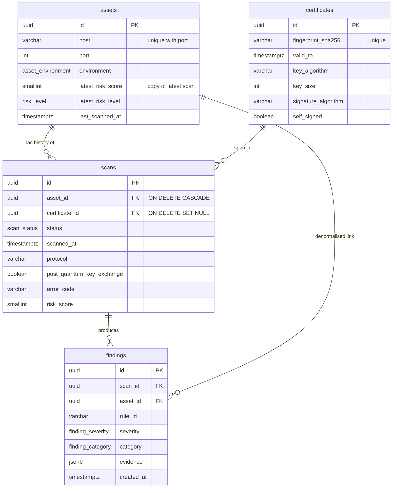

# CryptoScope

A mini **cryptographic inventory and risk assessment** platform. It scans TLS endpoints, records which
algorithms, key sizes and protocol versions are in use, scores the risk (including exposure to future
quantum attacks), and shows it all on a dashboard.

> Work in progress — built step by step. See [Roadmap](#roadmap).

## Tech stack

| Layer          | Technology                                 |
| -------------- | ------------------------------------------ |
| Backend API    | NestJS 11 (TypeScript), TypeORM            |
| Frontend       | Next.js 16 (React 19), Tailwind CSS 4      |
| Database       | PostgreSQL 17                              |
| Search / logs  | Elasticsearch 8.19 + Kibana                |
| Queue          | Redis 7 (BullMQ in Step 6)                 |
| Tests          | Jest                                       |

## Repository layout

```
CryptoScope/
├── backend/            NestJS API (port 3001, prefix /api)
├── frontend/           Next.js dashboard (port 3000)
├── scripts/            helper scripts (smoke tests, seeders, log generators)
├── docker-compose.yml  the whole stack
└── .env.example        configuration template
```

## Quick start (everything in Docker)

Requirements: Docker Desktop or Rancher Desktop with **at least 4 GB of memory** for the VM
(Elasticsearch + Kibana are the heavy ones).

```bash
cp .env.example .env
docker compose up --build
```

First start takes a few minutes (image downloads, Elasticsearch boot). Then:

| Service          | URL                                    |
| ---------------- | -------------------------------------- |
| Dashboard        | http://localhost:3000                  |
| API liveness     | http://localhost:3001/api/health       |
| API readiness    | http://localhost:3001/api/health/ready |
| Elasticsearch    | http://localhost:9200                  |
| Kibana           | http://localhost:5601                  |
| PostgreSQL       | `localhost:5434` (user/db from `.env`) |
| Redis            | `localhost:6379`                       |

Check everything at once:

```bash
./scripts/check-health.sh
```

Stop with `docker compose down` (add `-v` to also delete the data volumes).

## Local development (hot reload)

Run only the infrastructure in Docker, and the apps on your machine:

```bash
docker compose up -d postgres redis elasticsearch kibana

cd backend && npm install && npm run start:dev     # http://localhost:3001/api
cd frontend && npm install && npm run dev          # http://localhost:3000
```

The backend reads the root `.env`, where hosts are `localhost`. Inside Docker, `docker-compose.yml`
overrides them with service names (`postgres`, `redis`, `elasticsearch`).

## Tests

```bash
cd backend && npm test          # unit tests, no infrastructure needed
cd backend && npm run test:e2e  # real app + real Postgres and Elasticsearch (needs the Docker stack; uses a test DB and a temporary index)
```

The scanner tests start real TLS servers on `127.0.0.1` (TLS 1.3, TLS 1.0-only, PQ and non-PQ key exchange),
so they cover the real handshake code without needing internet access.

## TLS scanner

Connects to each target, completes a TLS handshake and records:

- protocol version, cipher suite and key exchange group
- whether the server supports **hybrid post-quantum key exchange** (`X25519MLKEM768`)
- certificate subject, issuer, SANs, validity dates, fingerprint
- public key algorithm and size (RSA, EC, Ed25519, ML-DSA) and signature algorithm
- trust result (`CERT_HAS_EXPIRED`, `DEPTH_ZERO_SELF_SIGNED_CERT`, ...) without refusing to connect

Targets are scanned in parallel with a concurrency limit and a per-connection timeout
(`SCAN_CONCURRENCY`, `SCAN_TIMEOUT_MS`). One failing host never affects the others.

From the command line (no server needed):

```bash
cd backend
npm run scan                               # scan the seed targets
npm run scan -- github.com example.com:8443
npm run scan -- --json google.com          # full JSON output
```

## Risk scoring

Every successful scan is run through a rules engine ([backend/src/risk/rules.ts](backend/src/risk/rules.ts)).
Each rule is a pure function that returns a finding (with evidence and a recommendation) or nothing.

| Rule                     | Severity                    | Why it matters                                           |
| ------------------------ | --------------------------- | -------------------------------------------------------- |
| `CERT_EXPIRED`           | critical                    | Clients reject the certificate                           |
| `CERT_EXPIRING_SOON`     | high (< 30 days)            | Most common cause of outages                             |
| `WEAK_RSA_KEY`           | high (< 2048 bits)          | Below NIST minimums                                      |
| `WEAK_SIGNATURE_HASH`    | high (SHA-1), critical (MD5) | Practical collisions allow forged certificates          |
| `LEGACY_TLS_VERSION`     | high (TLS 1.0/1.1), critical (SSLv3) | Deprecated by RFC 8996                          |
| `CERT_SELF_SIGNED`       | medium                      | No trusted third party vouches for the server            |
| `CERT_UNTRUSTED_CHAIN`   | medium                      | Any other chain validation failure                       |
| `QUANTUM_VULNERABLE_KEY` | medium (any RSA / ECC key)  | Shor's algorithm breaks RSA and elliptic-curve keys      |
| `NO_PQ_KEY_EXCHANGE`     | medium                      | "Harvest now, decrypt later" on recorded traffic         |

**Score (0–100)** = sum of finding weights (critical 50, high 25, medium 10, low 3), capped at 100.
**Level** = the worst finding's severity, so a single critical issue is never hidden by a low score.
Only a fully post-quantum server (ML-DSA certificate + hybrid ML-KEM key exchange, TLS 1.3) scores 0.

## Data model (PostgreSQL)



- **Certificates are stored once per fingerprint** and shared by scans (an `INSERT ... ON CONFLICT` upsert).
- **Every scan is kept**, including failed ones, so we have history. `assets.latest_risk_*` is a denormalised
  copy of the newest successful scan, so listing assets by risk needs no join.
- **Schema changes are migrations** in `backend/src/database/migrations` (`synchronize` is off). They run
  automatically when the backend starts.

```bash
cd backend
npm run migration:show                                         # what's applied
npm run migration:generate -- src/database/migrations/AddX     # diff entities -> new migration
npm run migration:revert                                       # undo the last one
npm run seed                                                   # 20k assets, 100k scans, ~200k findings (~20 s)
npm run db:explain-demo                                        # slow query -> index -> 214x faster
```

The query optimisation walkthrough (EXPLAIN ANALYZE before/after) is in
[docs/query-optimization.md](docs/query-optimization.md).

## TLS handshake analytics (Elasticsearch)

PostgreSQL holds the inventory; Elasticsearch holds the **traffic**: one document per TLS handshake.

```bash
cd backend
npm run logs:generate    # 500,000 fake handshakes over the last 7 days, bulk-indexed in ~5 s
```

- Explicit mapping (`keyword` vs `text`, `ip`, `date`, `dynamic: strict`) in a versioned index behind the
  `tls-handshakes` alias. Re-generating swaps the alias atomically (zero downtime).
- Four aggregation endpoints: key algorithm counts (`terms`), weak handshakes per hour
  (`date_histogram` + `filter`), top hosts with RSA < 2048, and the share of quantum-vulnerable traffic.
- A search endpoint that shows **query context** (scored full-text) and **filter context** (exact, cacheable) side by side.
- The script also creates a Kibana data view, so the logs are ready in Discover.

Mapping decisions, query vs filter context and optimisation tips: [docs/elasticsearch.md](docs/elasticsearch.md).

## API

| Method | Path                | Description                                                      |
| ------ | ------------------- | ---------------------------------------------------------------- |
| GET    | `/api/health`       | Liveness: the process is up. Used by Docker's healthcheck.       |
| GET    | `/api/health/ready` | Readiness: Postgres, Redis and Elasticsearch reachable (or 503). |
| GET    | `/api/scanner/seed-targets` | The demo target list.                                    |
| POST   | `/api/scanner/scan` | Scan up to 50 targets: `{ "targets": ["github.com", "host:8443"] }`. Each result includes its risk assessment. |
| GET    | `/api/risk/rules`   | All risk rules with severity, category and rationale, plus the score weights. |
| POST   | `/api/assets`       | Create an asset: `{ "host": "github.com", "port": 443, "label": "...", "environment": "production" }` |
| GET    | `/api/assets`       | List assets. Filters: `search`, `riskLevel` (comma list), `environment`. Sort: `riskScore`, `host`, `lastScannedAt`, `createdAt`. Paging: `page`, `pageSize` (max 100), `order`. |
| GET    | `/api/assets/:id`   | One asset. |
| PATCH  | `/api/assets/:id`   | Update host, port, label or environment. |
| DELETE | `/api/assets/:id`   | Delete an asset with its scans and findings. |
| POST   | `/api/assets/:id/scans` | Scan the asset now and store the scan, certificate and findings. |
| GET    | `/api/assets/:id/scans` | Scan history, newest first (paginated). |
| GET    | `/api/scans/:id`    | One scan with its certificate and findings. |
| GET    | `/api/analytics/handshakes/key-algorithms` | Handshake count per key algorithm, with key sizes. All analytics endpoints accept `from`, `to` (ISO 8601, default last 7 days). |
| GET    | `/api/analytics/handshakes/weak-per-interval` | Weak handshakes per `interval` (`1h` default, up to `1d`), plus totals by reason. |
| GET    | `/api/analytics/handshakes/top-weak-rsa-hosts` | Top `limit` (default 10) hosts still using RSA < 2048. |
| GET    | `/api/analytics/handshakes/quantum-vulnerable` | Percentage of traffic using a quantum-vulnerable key exchange, by group. |
| GET    | `/api/analytics/handshakes/search` | Log search: `q` (full-text on user agent), `tlsVersion`, `host`, `page`, `pageSize`. |
| GET    | `/api/findings`     | List findings. Filters: `severity`, `category`, `ruleId` (comma lists), `assetId`, `from`, `to`. Sort: `createdAt`, `severity`. Paginated. |

## Roadmap

- [x] Step 1 – Project setup, docker-compose, health checks
- [x] Step 2 – TLS scanner service
- [x] Step 3 – Risk scoring engine
- [x] Step 4 – PostgreSQL data model + query optimization
- [x] Step 5 – Elasticsearch log analytics
- [ ] Step 6 – Async pipeline (BullMQ) + real-time (Socket.IO)
- [ ] Step 7 – Security (JWT, roles, validation, rate limiting)
- [ ] Step 8 – Dashboard
- [ ] Step 9 – Crypto-agility module
- [ ] Step 10 – Final polish

