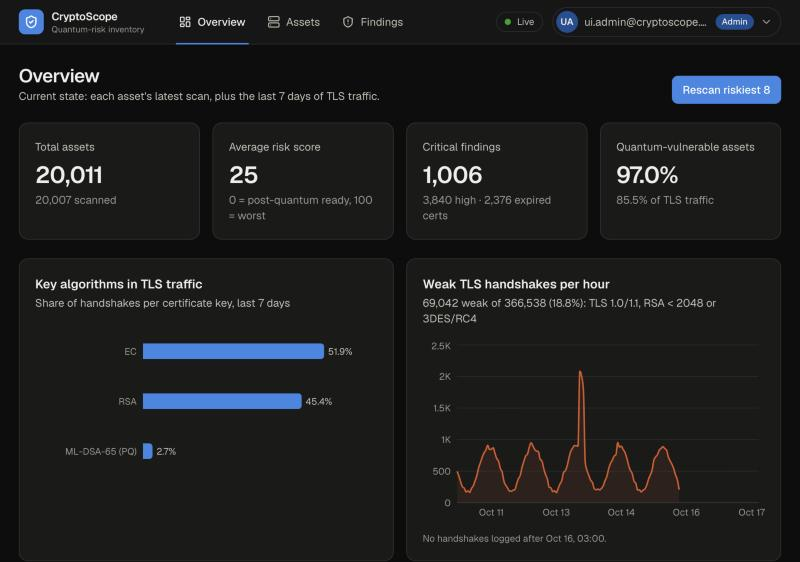
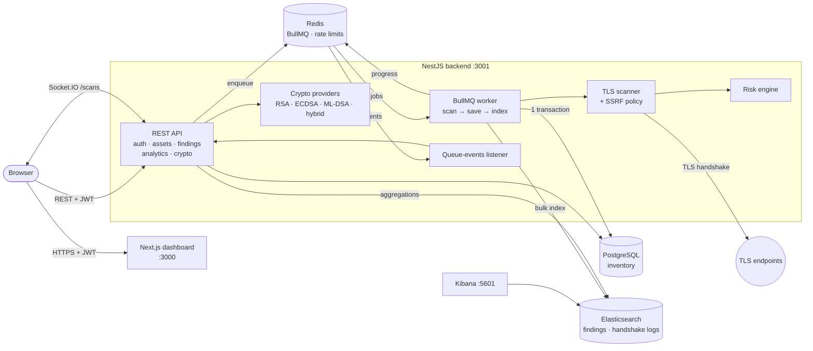
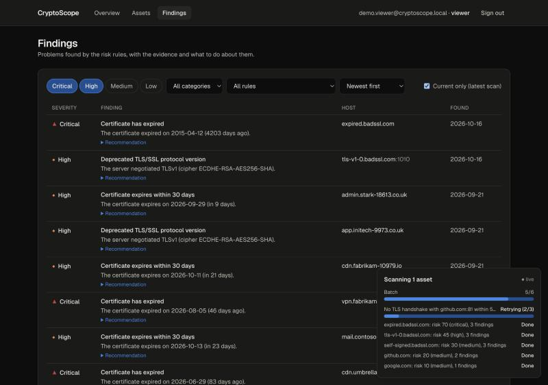
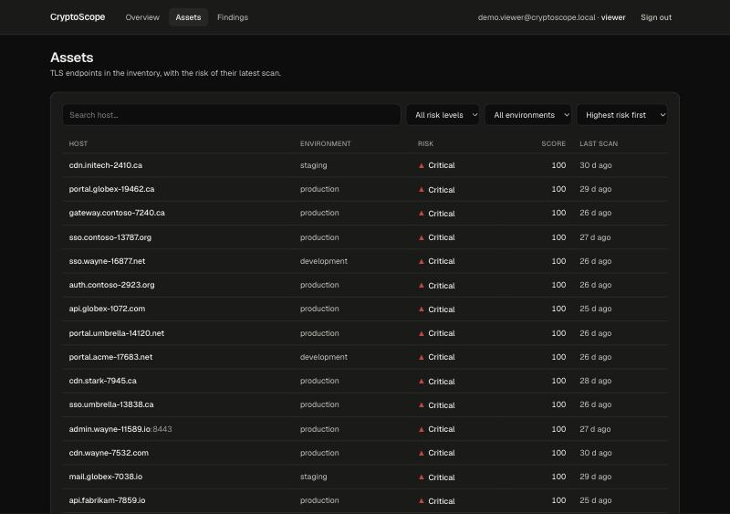
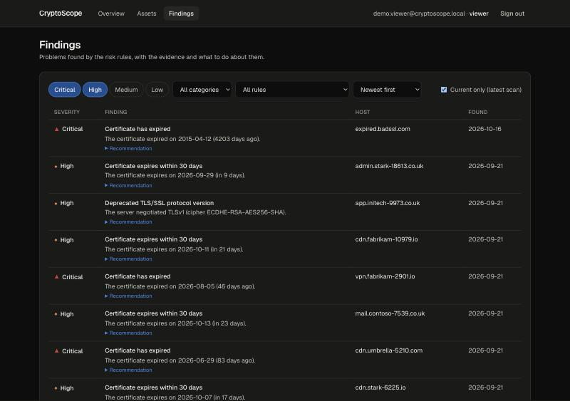
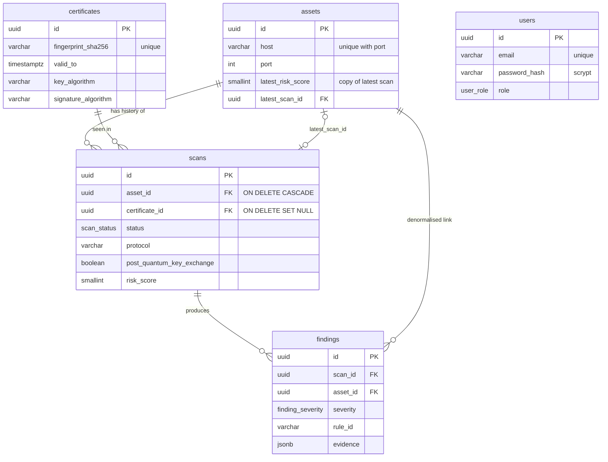

# CryptoScope

[](https://github.com/mnahsanofficial/CryptoScope/actions/workflows/ci.yml)

**A cryptographic inventory and quantum-risk dashboard.** CryptoScope scans TLS endpoints, records every algorithm,
key, certificate and protocol it finds, scores the risk (including exposure to future quantum computers), analyses
TLS traffic at scale, and shows it all live on a dashboard. A crypto-agility module demonstrates how to move from
RSA/ECDSA to the post-quantum **ML-DSA** signature standard by changing configuration, not code.

Built as a portfolio project, in the spirit of crypto-inventory tools such as ISARA Advance, with NestJS, Next.js,
PostgreSQL, Elasticsearch, BullMQ and Socket.IO.



## What it does

| | |
| --- | --- |
| **Discover** | A TLS scanner reads the protocol, cipher, key exchange, certificate key and signature algorithm of any host, and detects **hybrid post-quantum key exchange** (`X25519MLKEM768`). |
| **Assess** | A rules engine turns each scan into findings (expired certs, weak RSA, SHA-1, TLS 1.0, quantum-vulnerable keys, no PQ key exchange) and a 0–100 risk score. |
| **Inventory** | PostgreSQL keeps assets, the full scan history, deduplicated certificates and findings: 350k+ rows of seed data, with indexed queries. |
| **Analyse traffic** | Elasticsearch aggregates 500k TLS handshake logs: key algorithms, weak handshakes per hour, hosts with RSA < 2048, % quantum-vulnerable traffic. |
| **Scale** | Scans run as BullMQ jobs with retries and backoff; progress streams to the browser over Socket.IO. |
| **Protect** | JWT auth with admin/viewer roles, scrypt passwords, rate limiting, security headers, SSRF protection. |
| **Migrate** | A crypto-agility module signs with RSA, ECDSA, **ML-DSA-65** or a **hybrid ECDSA + ML-DSA**, selected by config. |

## How this relates to quantum-safe security

**The threat.** A large enough quantum computer running **Shor's algorithm** breaks RSA and elliptic-curve
cryptography, the basis of almost every TLS certificate, code signature and key exchange today. Two consequences:

- **Harvest now, decrypt later:** traffic recorded *today* with classical key exchange (ECDH, RSA) can be decrypted
  once such a computer exists. Long-lived secrets are already at risk.
- **Forgery later:** RSA/ECDSA signatures (certificates, firmware, documents) become forgeable, so trust has to move
  to new algorithms before that happens.

**The response.** NIST standardised post-quantum algorithms in 2024: **ML-KEM** (FIPS 203) for key exchange and
**ML-DSA** (FIPS 204) for signatures, and plans to deprecate RSA/ECC around 2030 and disallow them by 2035
(NIST IR 8547). Migrating a large organisation takes years, and it starts with knowing where the vulnerable
cryptography is.

**How CryptoScope maps to that migration:**

| Migration step | What CryptoScope does | Where |
| --- | --- | --- |
| **1. Discover**: find all cryptography in use | Scans endpoints and parses certificates, including ML-DSA certificates Node can't parse itself (a small DER reader) | [scanner](backend/src/scanner), [Step 2](https://github.com/mnahsanofficial/CryptoScope/pull/1) |
| **2. Assess**: which assets are quantum-vulnerable? | `QUANTUM_VULNERABLE_KEY` for every RSA/ECC key; `NO_PQ_KEY_EXCHANGE` when hybrid ML-KEM isn't negotiated | [risk rules](backend/src/risk/rules.ts) |
| **3. Measure exposure**: how much traffic is at risk? | % of TLS handshakes using classical key exchange (85% in the sample data) | [analytics](backend/src/analytics), [docs](docs/elasticsearch.md) |
| **4. Prioritise** | Risk score and level per asset; current findings; expiring certificates (renewal = migration opportunity) | [dashboard](docs/dashboard.md) |
| **5. Become crypto-agile** | Algorithms behind one interface, chosen by config; signatures name their algorithm so old and new coexist | [crypto-agility](docs/crypto-agility.md) |
| **6. Migrate safely** | ML-DSA-65 signing for real (Node.js 24), and **hybrid** ECDSA + ML-DSA that stays secure if either algorithm holds | [Step 9](https://github.com/mnahsanofficial/CryptoScope/pull/8) |

What the real-world scans show: google.com and cloudflare.com already negotiate hybrid **X25519MLKEM768** key
exchange, github.com doesn't, and every certificate scanned still uses a quantum-vulnerable RSA or ECDSA key. That
is today's typical picture: key exchange is migrating first (harvest-now-decrypt-later), and signatures are next.
And the cost is real: an ML-DSA-65 signature is **3,309 bytes vs 71 for ECDSA**, which matters for certificate
chains, TLS handshakes and constrained devices.

## Architecture



| Path | What happens |
| --- | --- |
| **Start a scan** | `POST /api/scan-jobs` → job in Redis → `202 Accepted` → the worker scans, applies the risk rules, saves in one Postgres transaction, indexes findings into Elasticsearch. Retries use exponential backoff, and every step is idempotent. |
| **Live progress** | worker → `job.updateProgress()` → Redis stream → each API process → Socket.IO → browser. Workers can run in separate containers. |
| **Dashboard data** | Inventory from PostgreSQL (each asset's latest scan); traffic analytics from Elasticsearch aggregations. |

More detail: [async pipeline](docs/async-pipeline.md) · [data model](#data-model) · [security](docs/security.md).

## Quick start

Requirements: **Docker** (Docker Desktop or Rancher Desktop) with at least **4 GB of memory** for its VM.
Node.js 22+ is only needed for the seed scripts and local development.

```bash
git clone https://github.com/mnahsanofficial/CryptoScope.git && cd CryptoScope
cp .env.example .env
```

Edit `.env` and set the three secrets (the app refuses to start without them):

```bash
JWT_SECRET=          # openssl rand -base64 48
POSTGRES_PASSWORD=   # anything, local only
ADMIN_PASSWORD=      # 12+ characters; the first admin is ADMIN_EMAIL / ADMIN_PASSWORD
```

Start everything with one command (the first run downloads images and takes a few minutes):

```bash
docker compose up -d --build --wait
```

Optional: fill it with realistic data (the dashboard is more interesting with it):

```bash
cd backend && npm ci
npm run seed            # 20,000 assets, 100,000 scans, ~200,000 findings (~20 s)
npm run logs:generate   # 500,000 TLS handshake logs into Elasticsearch (~5 s)
```

| Service | URL |
| --- | --- |
| Dashboard | http://localhost:3000 (sign in with `ADMIN_EMAIL` / `ADMIN_PASSWORD`) |
| API | http://localhost:3001/api (health: `/api/health`, readiness: `/api/health/ready`) |
| Kibana | http://localhost:5601 (data view "TLS handshakes" is created by `logs:generate`) |
| Elasticsearch | http://localhost:9200 |
| PostgreSQL / Redis | `localhost:5434` / `localhost:6379` |

```bash
./scripts/check-health.sh   # checks every service
docker compose down         # stop (add -v to delete the data volumes)
```

### Local development (hot reload)

```bash
docker compose up -d postgres redis elasticsearch kibana
cd backend && npm run start:dev    # http://localhost:3001/api
cd frontend && npm run dev         # http://localhost:3000
```

The backend reads the root `.env` (hosts = `localhost`); inside Docker, compose overrides them with service names.

## Configuration

All settings come from environment variables (`.env`); see [.env.example](.env.example) for the full list.
**No secrets live in code**, and the app validates its configuration at startup.

| Variable | Default | Purpose |
| --- | --- | --- |
| `JWT_SECRET` | *(required, 32+ chars)* | Signs access tokens |
| `JWT_EXPIRES_IN` | `1h` | Access token lifetime |
| `ADMIN_EMAIL` / `ADMIN_PASSWORD` | – | First admin, created only when no users exist |
| `POSTGRES_*`, `REDIS_*`, `ELASTICSEARCH_NODE` | see `.env.example` | Connections (Postgres host port 5434) |
| `CRYPTO_SIGNATURE_ALGORITHM` | `ECDSA-P256-SHA256` | `RSA-PSS-3072-SHA256`, `ML-DSA-65`, `HYBRID-ECDSA-P256+ML-DSA-65` |
| `SCAN_TIMEOUT_MS` / `SCAN_CONCURRENCY` | `5000` / `10` | Per-connection timeout, parallel hosts per scan |
| `SCAN_WORKER_CONCURRENCY` / `SCAN_JOB_ATTEMPTS` / `SCAN_RETRY_DELAY_MS` | `5` / `3` / `2000` | Queue worker, retries, backoff |
| `SCAN_ALLOW_PRIVATE_TARGETS` | `false` | SSRF protection; `true` only for local testing |
| `RATE_LIMIT` / `RATE_LIMIT_TTL_MS` | `100` / `60000` | Requests per IP per window (login: 5/min) |
| `TRUST_PROXY_HOPS` | `0` | Set behind a load balancer so rate limits use the real client IP |

## API

All endpoints except login and health need `Authorization: Bearer <token>`. 🔒 = admin only (viewers get 403).
Get a token:

```bash
curl -s -X POST localhost:3001/api/auth/login -H 'content-type: application/json' \
  -d '{"email":"admin@cryptoscope.local","password":"<ADMIN_PASSWORD>"}'
```

**Auth and users**

| Method | Path | Description |
| --- | --- | --- |
| POST | `/api/auth/login` | `{ email, password }` → `{ accessToken, tokenType, user }`. Public; 5 attempts/min |
| GET | `/api/auth/me` | The current user |
| POST / GET | `/api/users` | 🔒 Create (`{ email, password, role }`) / list users |

**Inventory and scanning**

| Method | Path | Description |
| --- | --- | --- |
| GET / POST | `/api/assets` | List (`search` also accepts URLs or `host:port`, `riskLevel`, `environment`, `sort`, `order`, `page`, `pageSize`) / 🔒 create `{ host, port, label, environment, scanNow }`: queues the first scan unless `scanNow: false` |
| GET / PATCH / DELETE | `/api/assets/:id` | Read / 🔒 update / 🔒 delete (cascades to scans and findings) |
| POST | `/api/assets/:id/scans` | 🔒 Queue a scan → `202 { jobId, scanId, created }` |
| POST | `/api/scan-jobs` | 🔒 Queue a batch `{ assetIds }` → `202 { batchId, total, jobs }` |
| GET | `/api/scan-jobs`, `/api/scan-jobs/:jobId`, `/api/scan-jobs/batches/:batchId` | Queue counts, one job, batch progress |
| GET | `/api/assets/:id/scans`, `/api/scans/:id` | Scan history; one scan with certificate and findings |
| GET | `/api/findings` | Filters `severity`, `category`, `ruleId`, `assetId`, `from`, `to`, `latestOnly`; sort `createdAt` or `severity`; paginated |
| GET | `/api/certificates/expiring` | Certificates in use expiring within `days` (default 30), most urgent first |
| GET | `/api/dashboard/overview` | Totals, average risk, current findings, % quantum-vulnerable, expiring certificates |
| POST | `/api/scanner/scan` | 🔒 Ad-hoc scan of up to 50 targets, with risk assessments (not stored) |
| GET | `/api/scanner/seed-targets`, `/api/risk/rules` | Demo targets; risk rules and weights |

**TLS traffic analytics (Elasticsearch)**: all accept `from` and `to` (ISO 8601, default: last 7 days)

| Method | Path | Description |
| --- | --- | --- |
| GET | `/api/analytics/handshakes/key-algorithms` | Count by key algorithm (`terms`) with key sizes |
| GET | `/api/analytics/handshakes/weak-per-interval` | Weak handshakes per `interval` (`date_histogram` + `filter`), by reason |
| GET | `/api/analytics/handshakes/top-weak-rsa-hosts` | Top `limit` hosts still using RSA < 2048 |
| GET | `/api/analytics/handshakes/quantum-vulnerable` | % of traffic with quantum-vulnerable key exchange, by group |
| GET | `/api/analytics/handshakes/search` | Full-text `q` (query context) + `tlsVersion`, `host` filters (filter context) |

**Crypto-agility**

| Method | Path | Description |
| --- | --- | --- |
| GET | `/api/crypto/providers` | Algorithms: family, quantum-safe, available, active, measured sizes and speed |
| POST | `/api/crypto/sign` | 🔒 `{ message, algorithm? }` → `{ algorithm, keyId, signature, publicKey, quantumSafe }` |
| POST | `/api/crypto/verify` | `{ message, algorithm, signature, keyId \| publicKey }` → `{ valid }` |

**Health**: `GET /api/health` (liveness) and `GET /api/health/ready` (readiness: Postgres, Redis, Elasticsearch) are public.

**Live events**: Socket.IO namespace `/scans` (`io(url + "/scans", { auth: { token } })`) emits `scan.progress` and `batch.progress`.

## Screenshots

| Overview | Live scan progress |
| --- | --- |
|  |  |
| **Assets** | **Findings** |
|  |  |

## Data model



Certificates are stored once per fingerprint; every scan is kept as history; `latest_*` columns are deliberate
denormalised copies for fast dashboards. Schema changes are hand-written migrations, checked against the entities.
One slow query and its fix (an index, **214x faster**, `EXPLAIN ANALYZE` before/after) is documented in
[docs/query-optimization.md](docs/query-optimization.md).

## Testing

| Suite | Command | Count | Covers |
| --- | --- | --- | --- |
| Backend unit | `cd backend && npm test` | 223 | Scanner (real local TLS servers), DER parser, every risk rule, mappers, query builders, worker retry policy, scrypt, JWT config, SSRF policy, crypto providers (shared contract tests) |
| Backend e2e | `cd backend && npm run test:e2e` | 57 | Real app + Postgres + Redis/BullMQ + Elasticsearch + Socket.IO: CRUD, async scans, retries, analytics with exact counts, auth/roles, an audit of every route, rate limits, sign/verify |
| Frontend | `cd frontend && npm test` | 23 | Live-event reducer, API client, session/JWT expiry, chart helpers, login form |

**CI** (GitHub Actions, [`.github/workflows/ci.yml`](.github/workflows/ci.yml)) runs, on every push and PR:

- backend type-check, unit tests and build on **Node 22 and 24** (on 24 the real ML-DSA tests run too);
- frontend lint, tests and production build;
- the e2e suite against real Postgres, Redis and Elasticsearch service containers;
- `npm audit` of production dependencies.

## Project structure

```
CryptoScope/
├── backend/                  NestJS API (Node.js 24 in Docker)
│   ├── src/scanner/          TLS scanner, DER certificate parser, SSRF policy
│   ├── src/risk/             risk rules + scoring engine
│   ├── src/assets|scans|findings/   inventory REST API (TypeORM)
│   ├── src/database/         migrations, seed (350k+ rows), EXPLAIN demo
│   ├── src/analytics/        Elasticsearch mapping, log generator, aggregations
│   ├── src/scan-jobs/        BullMQ producer/worker, Socket.IO gateway
│   ├── src/auth|users/       JWT, roles, scrypt
│   ├── src/crypto-agility/   CryptoProvider: RSA, ECDSA, ML-DSA, hybrid
│   └── test/                 e2e suites
├── frontend/                 Next.js 16 dashboard (Tailwind, Recharts, Socket.IO client)
├── docs/                     design notes per topic + screenshots
├── scripts/check-health.sh   smoke test for the whole stack
├── .github/workflows/ci.yml  CI
└── docker-compose.yml        the whole stack: one `docker compose up`
```

## Design documents

| Topic | Document |
| --- | --- |
| Query optimisation (EXPLAIN ANALYZE, composite index) | [docs/query-optimization.md](docs/query-optimization.md) |
| Elasticsearch mapping, aggregations, query vs filter context | [docs/elasticsearch.md](docs/elasticsearch.md) |
| Async pipeline: retries, idempotency, real-time | [docs/async-pipeline.md](docs/async-pipeline.md) |
| Security: auth, roles, scrypt, SSRF, secrets, production gaps | [docs/security.md](docs/security.md) |
| Dashboard: data flow, token storage, charts, CSP | [docs/dashboard.md](docs/dashboard.md) |
| Crypto-agility and post-quantum signatures | [docs/crypto-agility.md](docs/crypto-agility.md) |

## How it was built

Step by step, one reviewed pull request per step:

1. Project setup: monorepo, docker-compose, health checks
2. [TLS scanner with post-quantum key exchange detection](https://github.com/mnahsanofficial/CryptoScope/pull/1)
3. [Rule-based risk scoring](https://github.com/mnahsanofficial/CryptoScope/pull/2)
4. [PostgreSQL data model, REST API, 214x query optimisation](https://github.com/mnahsanofficial/CryptoScope/pull/3)
5. [Elasticsearch TLS handshake analytics](https://github.com/mnahsanofficial/CryptoScope/pull/4)
6. [Async pipeline with BullMQ and Socket.IO](https://github.com/mnahsanofficial/CryptoScope/pull/5)
7. [Security: JWT roles, scrypt, rate limiting, SSRF protection](https://github.com/mnahsanofficial/CryptoScope/pull/6)
8. [Next.js dashboard](https://github.com/mnahsanofficial/CryptoScope/pull/7)
9. [Crypto-agility with ML-DSA and hybrid signatures](https://github.com/mnahsanofficial/CryptoScope/pull/8)
10. Final polish: README, architecture, CI

## Limitations

This is a learning and portfolio project, not a production service. Notable gaps (see the honest list in
[docs/security.md](docs/security.md#10-not-production-ready-yet-honest-list)):

- Elasticsearch, Kibana and Redis run without authentication or TLS (local development only).
- Signing keys are generated in memory; production needs a KMS/HSM, persistence and rotation.
- Access tokens only (no refresh tokens or revocation) stored in `sessionStorage`; a backend-for-frontend with
  httpOnly cookies would be stronger.
- Scan targets are TLS endpoints only (no SSH, code signing, or source-code crypto discovery).
