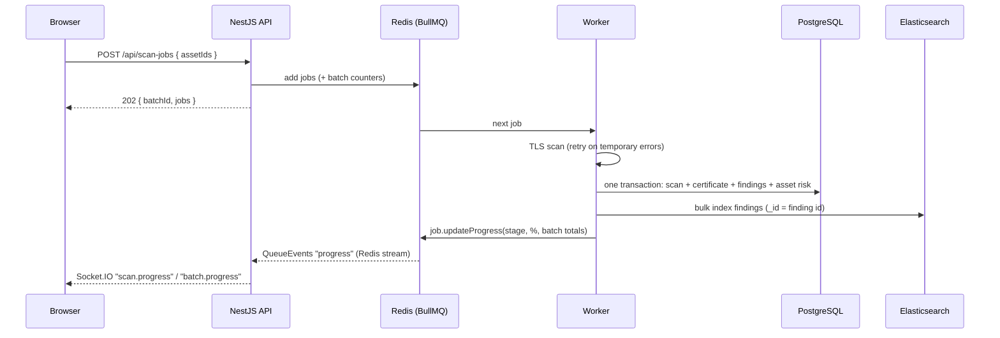

# Async scan pipeline: BullMQ + Socket.IO

Scanning a host can take seconds (DNS, TCP, TLS handshake, timeouts) and a batch can contain thousands of hosts.
So the API never scans inside the HTTP request. It **queues a job and answers `202 Accepted` right away**;
a worker does the work in the background and progress is pushed to the browser live.



## Try it

```bash
cd backend
npm run scans:watch          # terminal 1: prints live Socket.IO events
```

```bash
curl -s -X POST localhost:3001/api/assets -H 'content-type: application/json' -d '{"host":"github.com"}'
curl -s -X POST localhost:3001/api/assets/<asset id>/scans          # 202, then watch terminal 1
curl -s localhost:3001/api/scan-jobs/<job id>                      # state, attempts, result
```

## Job lifecycle and failure handling

Each job carries only ids: `{ assetId, scanId, batchId }`. The worker loads everything else from the database,
so the job is never stale.

| Situation | Example | What happens |
| --- | --- | --- |
| Success | handshake works | scanning, saving, indexing, completed |
| Temporary network error, attempts left | `TIMEOUT`, `CONNECTION_REFUSED`, `CONNECTION_RESET` | the worker throws, BullMQ retries with **exponential backoff** (2 s, 4 s, ...) |
| Temporary error on the **last** attempt | host still down | saved as a **failed scan** (history: "unreachable"), job completes |
| Permanent host error | `DNS_NOT_FOUND`, TLS handshake impossible | saved as a failed scan **immediately**: retrying can't help |
| Infrastructure error | Postgres or Elasticsearch down | the worker throws and BullMQ retries; after the last attempt the job stays in the **failed** set (a dead-letter queue to inspect and retry) |
| Bad job | asset deleted before the worker got to it | `UnrecoverableError`: failed at once, no retries |

Settings: `SCAN_JOB_ATTEMPTS` (default 3), `SCAN_RETRY_DELAY_MS` (default 2000), `SCAN_WORKER_CONCURRENCY` (default 5).
Completed jobs are kept 24 h and failed jobs 7 days, so Redis doesn't grow forever.

### Retries must be safe: idempotency

A job can run more than once (a retry, or a worker crash after it finished but before it acknowledged).
Every step is safe to repeat:

1. **The scan id is chosen when the job is created** (it is also the job id). Every attempt writes the *same* scan row.
2. **Saving is skipped if that scan row already exists**, so a job that saved but then failed while indexing doesn't scan again.
3. **Postgres writes are one transaction**: scan, certificate, findings and asset risk all succeed or none do.
4. **Elasticsearch documents use the finding id as `_id`**, so indexing twice overwrites instead of duplicating.
5. **Network I/O happens outside the transaction.** A slow scan never holds a database connection and locks.

### Deduplication

`deduplication: { id: "asset:<assetId>" }`: while a scan of an asset is waiting or running, another request for
the same asset returns the **existing** job (`created: false`) instead of scanning the host twice in parallel.

## Real-time progress: why through Redis?

The worker reports progress with `job.updateProgress()`. BullMQ publishes it to a Redis stream; a
`QueueEventsListener` in each API process forwards it to that process's Socket.IO clients.

The worker never talks to Socket.IO directly. So you can:

- run workers in **separate containers** (scale scanning independently of the API);
- run **several API instances** behind a load balancer: every instance receives every event from Redis, so a browser
  gets updates whichever instance it is connected to.

Socket.IO namespace `/scans`:

| Event | Payload |
| --- | --- |
| `scan.progress` | `{ jobId, assetId, scanId, batchId, stage, percent, attempt, maxAttempts, message?, result? }` |
| `batch.progress` | `{ batchId, total, completed, failed, percent }` |

Stages: `queued`, `scanning`, `saving`, `indexing`, `completed`, plus `retrying` and `failed`.
Batch totals are kept in a Redis hash and updated with `HINCRBY`, which is atomic, so concurrent workers never lose a count.

## Postgres and Elasticsearch: dual write

Postgres is the **source of truth**; the `cryptoscope-findings` index is a **read model** for full-text search and
fast aggregations. Writing to two stores can't be one transaction, so:

- Postgres is written first and committed; Elasticsearch second.
- If Elasticsearch fails, the job retries, and steps 2 and 4 above make the retry safe.
- If it still fails, the scan is in Postgres but not yet searchable. The job sits in the failed set and can be
  retried, or the index can be rebuilt from Postgres at any time.

At larger scale you'd use the **transactional outbox** pattern (write an "index this" row in the same Postgres
transaction, and have a separate process deliver it), or change data capture (Debezium) to stream changes into Elasticsearch.

## What would change in production

- Workers in their own deployment, scaled on queue length.
- A rate limit per target network (BullMQ `limiter`) so scanning never looks like an attack.
- Authentication on the Socket.IO namespace and rooms per tenant (Step 7 adds auth to the HTTP API).
- Alerts on the number of failed jobs, and a UI to retry them.
